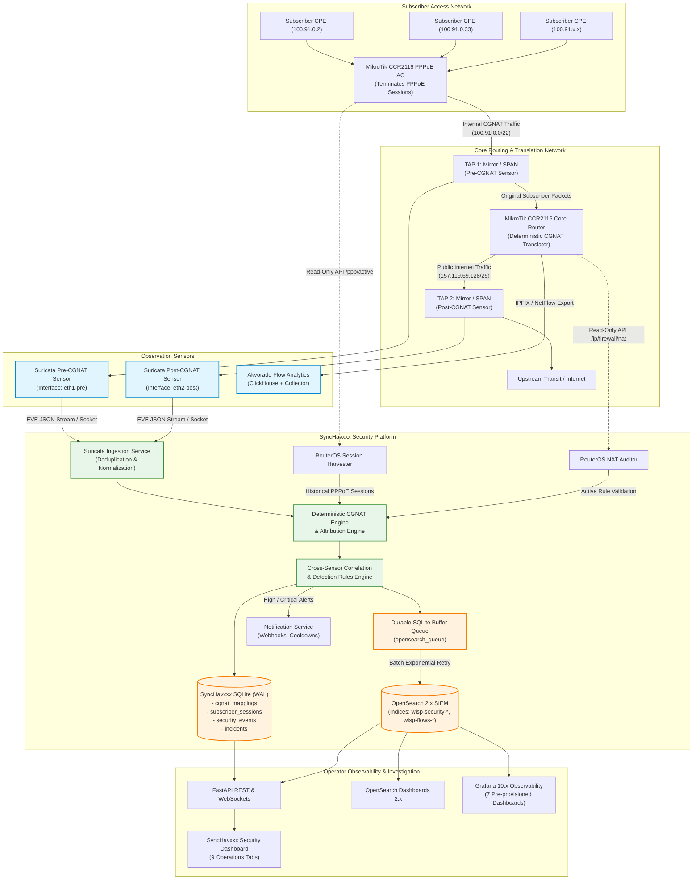
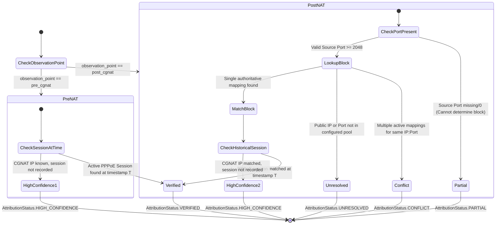
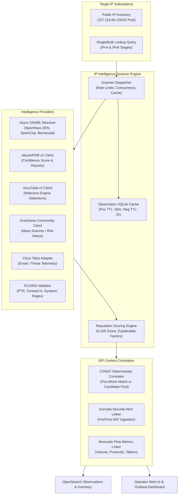

# WISPnet CGNAT Security Monitoring & Attribution Platform
## System Architecture & Network Topology Specification

---

### 1. Executive Summary & Core Objective

The **WISP Network & Data Solutions (WISPnet) Security Monitoring, Threat Detection & Subscriber Attribution Platform** is an independent, carrier-grade security operations system designed specifically for ISP environments operating MikroTik RouterOS v7 with deterministic Carrier-Grade NAT (CGNAT).

The primary mission of the platform is to solve the critical visibility gap created by address translation: when an external entity reports abusive behavior (DDoS participation, port scanning, malware command-and-control, spam) involving a shared public IPv4 address, or when internal sensors detect anomalous outbound/inbound traffic, the platform reliably correlates the event to the exact originating subscriber without guessing.

```
+----------------------------------------------------------------------------------------------------+
|                                    10 CORE ATTRIBUTION QUESTIONS                                   |
+----+---------------------------------------------------------------+-------------------------------+
| #  | Question                                                      | Attribution Engine Source     |
+----+---------------------------------------------------------------+-------------------------------+
| 1  | What attack or suspicious behavior was detected?             | Suricata alert / Engine rule  |
| 2  | What 5-tuple (src/dst IP, src/dst port, proto) was involved?  | Suricata EVE / Akvorado flow  |
| 3  | What was the original subscriber CGNAT IP before translation? | Pre-NAT sensor / CGNAT lookup |
| 4  | What translated public IP and port block were involved?       | Post-NAT sensor / CGNAT block |
| 5  | What PPPoE username/session corresponds to the CGNAT IP?      | RouterOS /ppp/active archive  |
| 6  | When did the activity occur?                                  | Microsecond event timestamp   |
| 7  | How many packets, bytes, connections, or flows were observed? | Event / Flow metrics          |
| 8  | How confident is the attribution?                             | Multi-tier attribution state  |
| 9  | What evidence supports the alert?                             | Raw EVE JSON + 5-tuple hash   |
| 10 | What action should the network administrator take?            | Prescribed action checklist   |
+----+---------------------------------------------------------------+-------------------------------+
```

**Zero Billing System Integration Guarantee:**
In strict compliance with architectural constraints, the platform has **no billing API, database connector, or automated account modification capabilities**. All operator lookups into customer management systems are performed manually through one-click copyable CGNAT IP and PPPoE username interfaces.

---

### 2. High-Level System Architecture Diagram



---

### 3. Dual Logical Observation Points

The system establishes two distinct observation points to achieve complete end-to-end visibility across NAT translation boundaries:

#### A. Pre-CGNAT Observation Point (`observation_point: pre_cgnat`)
- **Location:** Inter-router trunk between PPPoE Access Concentrator and Core Router (before source NAT).
- **Physical Interface:** Mirrored switch port / optical TAP (`sfp-sfpplus1-pre`).
- **Telemetry Collected:** Original subscriber CGNAT IP (`100.91.x.x`), unmapped source port, destination IP, destination port, protocol, TCP flags, DNS request/response payloads, Suricata signatures.
- **Primary Security Function:**
  1. Identifies malware infected subscriber CPEs and local LAN devices.
  2. Pinpoints brute-force authentication attacks (SSH/Telnet/RDP) before public translation.
  3. Detects internal DNS tunneling, botnet command-and-control beaconing, and outbound port scans.
  4. Provides immediate `verified` subscriber IP attribution without calculation.

#### B. Post-CGNAT Observation Point (`observation_point: post_cgnat`)
- **Location:** Internet-facing uplink on the Core Router (after deterministic source NAT).
- **Physical Interface:** Mirrored switch port / WAN optical TAP (`sfp-sfpplus2-post`).
- **Telemetry Collected:** Translated public IPv4 address (`157.119.69.x`), translated source port, destination IP, destination port, protocol, flow packet/byte rates.
- **Primary Security Function:**
  1. Correlates external abuse reports (from CERTs, hosting providers, spam blacklists) specifying public IP and port.
  2. Detects outbound volumetric flood attacks (SYN flood, UDP flood, DNS amplification) saturating upstream transit.
  3. Detects inbound attacks targeting public infrastructure or subscriber port blocks.
  4. Feeds deterministic port-to-subscriber reverse mapping calculations.

#### C. Cross-Sensor Correlation
When an alert is observed at either sensor, the **Cross-Sensor Correlation Engine** reconciles pre-NAT and post-NAT events:
- **Matching Criteria:** Destination IP, Destination Port, Protocol, and Timestamp.
- **Clock Drift Tolerance:** Configurable (default `3.0` seconds) to account for slight hardware TAP buffer skew or packet processing latency.
- **Port Block Containment:** Verifies that the post-NAT source port belongs to the deterministic block assigned to the pre-NAT subscriber IP.

---

### 4. Deterministic CGNAT Mapping & Historical Intervals

#### A. Deterministic Port-Block Algorithm
- **Public Pool:** `157.119.69.129` through `157.119.69.254` (126 usable public IPs in `/25`).
- **Subscriber Pool:** `100.91.0.2` through `100.91.3.255` (1,022 usable CGNAT IPs in `/22`).
- **Port Block Size:** 2,048 ports per subscriber.
- **Port Range:** Ports `2048` to `65535` (31 discrete non-overlapping blocks per public IP).
  - Block 1: `2048–4095`
  - Block 2: `4096–6143`
  - Block 3: `6144–8191`
  - ...
  - Block 31: `63488–65535`
- **Allocation Ratio:** `1:31` subscribers per public IP (guaranteeing 100% exclusivity, zero port wrapping, zero overlapping blocks).
- **Total Capacity:** 126 public IPs * 31 subscribers/IP = **3,906 subscriber capacity** (comfortably accommodating the 1,022 subscriber pool).

#### B. Historical Validity Intervals (`effective_from` & `effective_to`)
Subscribers may be reallocated different IP addresses or port blocks over time. To maintain forensic integrity:
- Every mapping record includes an `effective_from` timestamp and optional `effective_to` timestamp.
- When an abuse report arrives with historical timestamp $T$:
  $$\text{effective\_from} \le T \le \text{effective\_to (or active)}$$
- The engine matches the exact mapping active at timestamp $T$, guaranteeing zero false attributions after renumbering.

---

### 5. Multi-Tier Attribution State Model

Every security alert evaluated by the engine is assigned one of five strict attribution states:



1. **`verified`**: Both the subscriber CGNAT IP (via pre-NAT observation or deterministic post-NAT port block) AND the active PPPoE username at timestamp $T$ are authoritatively confirmed.
2. **`high_confidence`**: The subscriber CGNAT IP and port block are verified by deterministic mapping rules, but no concurrent PPPoE session was logged on the AC at timestamp $T$ (e.g. static IP assignment or session timeout).
3. **`partial`**: An external report specifies the public IP but **omits the source port** (or source port is 0). The system identifies the pool of subscribers sharing the IP but **explicitly refuses to guess**.
4. **`unresolved`**: The public IP, subscriber IP, or source port falls outside any configured CGNAT pool or historical validity interval.
5. **`conflict`**: Multiple overlapping or conflicting allocation rules match the target coordinates. Triggers an administrative audit alert.

---

### 6. Durable OpenSearch Buffer & Failover Architecture

To guarantee zero telemetry or alert loss during OpenSearch maintenance, cluster restarts, or network partitions:

1. **Dual-Path Persistence:**
   - Alerts and events are committed immediately to the local transactional SQLite database (`synchavxxx.db`, WAL mode).
   - Simultaneously, an index task is enqueued in the SQLite table `opensearch_queue`.
2. **Background Flush Worker:**
   - Runs in the application lifespan loop (`security_worker.py`).
   - Polls `opensearch_queue` for records with `status = 'pending'` in configurable batches (default 200).
   - Delivers documents to OpenSearch via `_bulk` HTTP indexing.
3. **Exponential Backoff & Health Tracking:**
   - On delivery failure (e.g. HTTP 503, connection refused), records remain in `pending` status with incremented attempt counters and backoff delays ($2^n \times \text{base}$).
   - `integration_health` records are updated in real time with queue depth, error count, and last failure message.
   - Once OpenSearch returns to green/yellow state, the worker drains the queue automatically without administrative intervention.

---

### 7. Detection Engine & Incident Correlation

- **Detection Categories:**
  - `outbound_scan`: Horizontal and vertical port scanning activity.
  - `outbound_ddos`: High-rate SYN/UDP flooding originating from subscriber IPs.
  - `brute_force`: Repeated credential stuffing on ports 22 (SSH), 23 (Telnet), 3389 (RDP), 80/443.
  - `botnet_c2`: Traffic communicating with known malware command-and-control servers.
  - `dns_anomaly`: Excessive NXDOMAIN rates, DNS tunneling patterns, or rogue DNS server queries.
  - `inbound_ddos`: Volumetric reflection or amplification attacks targeting public pools.
- **Incident Aggregation (Sliding Window):**
  - Related alerts sharing the same subscriber IP, attack category, or destination within a 15-minute sliding window are consolidated into a single unified `Incident`.
  - Prevents alert fatigue and groups timeline events chronologically.
- **Mandatory Resolution Accountability:**
  - High and Critical severity incidents cannot be marked `resolved` or `closed` without entering an operator resolution note ($\ge 10$ characters).
  - All changes are recorded in the tamper-evident `security_audit_logs` table.

---

### 8. IP Reputation, Blacklist Intelligence & Threat Correlation Architecture



#### 8.1 Multi-Source Intelligence Providers
The platform integrates eight authoritative threat intelligence feeds:
1. **Spamhaus ZEN (`zen.spamhaus.org`)**: SBL (127.0.0.2), CSS (127.0.0.3), XBL (127.0.0.4–7 botnets), and PBL (127.0.0.10–11). Detects and differentiates open resolver rate-limits (`127.255.255.254/255`).
2. **SpamCop (`bl.spamcop.net`)**: Real-time spam emission detection via honeypot traps.
3. **Barracuda BRBL (`b.barracudacentral.org`)**: High-accuracy IP reputation blocklist.
4. **AbuseIPDB (v2 API)**: Crowdsourced abuse reports, reporter counts, confidence score, and attack categorization.
5. **VirusTotal (v3 API)**: Correlates multiple antimalware and threat intelligence engines.
6. **GreyNoise Community**: Distinguishes benign mass internet scanners from targeted malicious activity.
7. **Cisco Talos Intelligence**: Enterprise reputation and threat categorization.
8. **Reverse DNS & Forward-Confirmed Reverse DNS (FCrDNS)**: Validates PTR records, confirms A record forward match, and evaluates dynamic naming patterns (`pool-*`, `dyn-*`, `dsl-*`).

#### 8.2 Honest State Tracking & Error Transparency
The platform strictly forbids fabricating threat intelligence or status results:
- If external API credentials or zones are not configured, the provider returns `status="unsupported"` with `error_type="unconfigured_credentials"`.
- If a query fails or times out, it is recorded as `error_type="network_timeout"` or `"service_unavailable"`.
- The aggregate status explicitly reflects `INCOMPLETE` or `UNKNOWN` when authoritative checks fail, rather than presenting a false-clean assertion.

#### 8.3 Deterministic CGNAT Attribution with Zero Guessing
- **With Source Port ($P > 0$):** Exactly pinpoints the subscriber CGNAT IP (`100.91.x.x`), the assigned 2,048-port block (`P_start - P_end`), and the active PPPoE session from historical records. Confidence tier: `verified` or `high_confidence`.
- **Without Source Port:** The platform **strictly refuses to guess**. It returns `partial` attribution, enumerating the exact candidate subscribers sharing the public IP, and notifies the administrator that source port telemetry is required to isolate the offending customer.
